# SPPIO Releases & Rollouts — Institution Operations Guide

**Document version:** 1.0
**Prepared:** 11 November 2026
**Applies to:** SPPIO/ExamOS Console v3.0.0, Module 14 (Secure OS Release, Updates, Rollback & Deployment)
**Audience:** Institution administrators, release engineers, IT/device administrators, security reviewers and auditors
**Screenshots:** Captured from a live local deployment of the real console and the real C backend, connected to PostgreSQL. No mock-ups.

---

## 1. Purpose of this guide

This guide explains, page by page, how an institution works with the two release-management areas of the SPPIO console:

- **Releases & rollout → Releases** (`/admin/releases`, plus the release detail page `/releases/:id`)
- **Releases & rollout → Rollouts** (`/release-rollouts`)

It also covers the closely connected **Validation & evidence** page (`/release-validation`) because release approval and rollout depend on the evidence recorded there.

The guide describes:

1. What each screen shows.
2. What each button actually does against the backend.
3. Which fields are mandatory and how they are validated.
4. What the system *does not* do yet, so institutions do not mistake a deployment record for a completed device update.
5. The safe operating procedure for creating, verifying, approving, rolling out, suspending (where supported), revoking and recovering releases.

> **Critical distinction**
>
> The release pages manage **release records**. They do not, by themselves, build an OS image, sign a manifest, assign devices, dispatch an update, install software on a device, or prove that a device booted successfully. A persisted deployment group is **not** a device rollout.

---

## 2. Where to find the pages

| Page | Route | Navigation label |
|---|---|---|
| Releases | `/admin/releases` | Releases & rollout → Releases |
| Release detail | `/releases/:id` | Opened from a release row |
| Rollouts | `/release-rollouts` | Releases & rollout → Rollouts |
| Validation & evidence | `/release-validation` | Releases & rollout → Validation & evidence |

Console origin configured in the repository: `https://sppio-os.vercel.app` (listed in the backend CORS allow-list; its live deployment status was not verified for this guide).
Local/development console used for the screenshots: `http://127.0.0.1:5173/login`

---

## 3. Roles and permissions

Release controls are permission-gated in the frontend and re-checked by the backend. The release-related permissions are:

| Permission | What it allows |
|---|---|
| `release.view` | Open Releases, release detail, Rollouts and Validation & evidence |
| `release.manage` | Create release drafts, submit evidence, revoke/suspend/retire, recover devices |
| `release.approve` | Submit a release approval request |
| `release.rollout` | Submit rollback/recovery requests and create deployment plans |

Role matrix as implemented in `frontend/src/core/security/rbac.js`:

| Role | View | Manage | Approve | Rollout |
|---|:---:|:---:|:---:|:---:|
| Platform Super Admin | ✅ | ✅ | ✅ | ✅ |
| Release Engineer | ✅ | ✅ | — | ✅ |
| Operations Admin (legacy) | ✅ | ✅ | — | ✅ |
| IT / Device Administrator | ✅ | — | — | ⚠️ (button only) |
| Institution Admin | ✅ | — | — | — |
| Security Engineer | ✅ | — | — | — |
| Security Auditor | ✅ | — | — | — |
| Other institution roles | — | — | — | — |

**Practical consequence:** only the Platform Super Admin currently holds `release.approve`. Because the frontend also blocks self-approval, an institution that needs separation of duties must have **at least two Platform Super Admin accounts**: one person creates the release, a different person approves it.

> **⚠️ Rollout permission inconsistency**
>
> The IT / Device Administrator role holds `release.rollout` but not `release.manage`. The **Roll out** button is therefore visible to that role on an eligible release, but the frontend rollout service (`frontend/src/modules/releases/service.js`) additionally calls `need(actor, 'release.manage')` before it will persist a deployment group. In this build an IT / Device Administrator cannot actually create a deployment plan; use a Release Engineer, Operations Admin or Platform Super Admin account. Do not treat a visible button as a granted capability.

> **Institution isolation caveat**
>
> In this build the release register is fetched from `GET /api/v1/os/releases` without an institution filter, and the Rollouts page lists all deployment groups returned by the backend. Do not rely on the institution selector in the top bar to isolate release data. Until tenant-scoped release queries are implemented, treat these pages as platform-level controls and restrict access accordingly.

---

## 4. Before you begin

### 4.1 Access checklist

- [ ] A management-console account with the required release permissions.
- [ ] An authenticator app enrolled for MFA (mandatory for management accounts).
- [ ] Recovery codes stored in your institution's password vault.
- [ ] A documented release version and component list approved by your release manager.
- [ ] A second authorised person for approval (separation of duties).
- [ ] Your institution's change record / maintenance window reference.

### 4.2 What the console will **not** ask you for

The release pages never ask for, transmit or store:

- private signing keys,
- TPM private material,
- OS image binaries,
- database credentials.

Only metadata, digests, evidence text/links and lifecycle state are stored. Artifact objects must live in private artifact storage; the UI has no upload control for OS images.

---

## 5. Signing in

### 5.1 Open the management console

Go to `/login` and choose **Admin Console** (not Candidate Station).

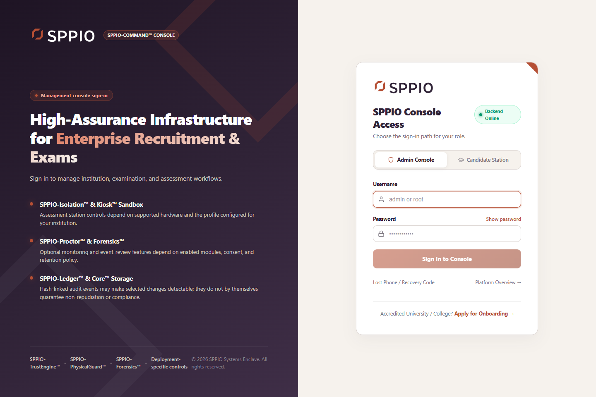

1. Enter your management username.
2. Enter your password (minimum 12 characters for newly provisioned accounts).
3. Select **Sign In to Console**.

### 5.2 Complete MFA

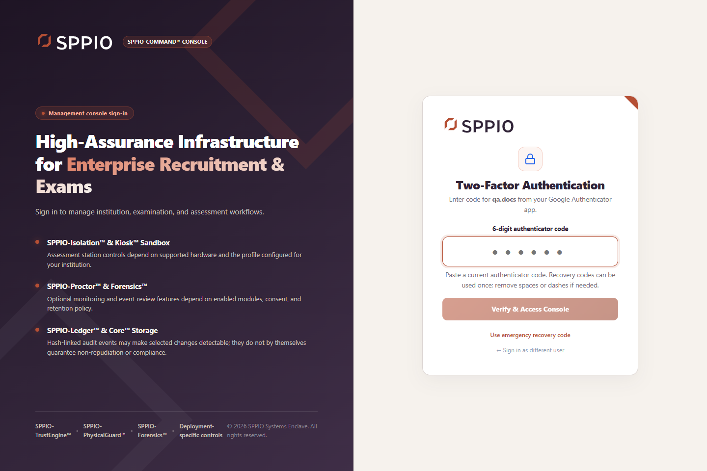

1. Enter the current 6-digit code from your authenticator app.
2. Select **Verify & Access Console**.
3. If the authenticator is unavailable, use **Use emergency recovery code**. Recovery codes are single-use.
4. First-time management accounts are asked to enrol an authenticator before access is granted.

Sessions last up to 8 hours. The bearer token is held in memory only; continuity is provided by an HttpOnly session cookie.

---

## 6. The Releases page

Open **Releases & rollout → Releases**.

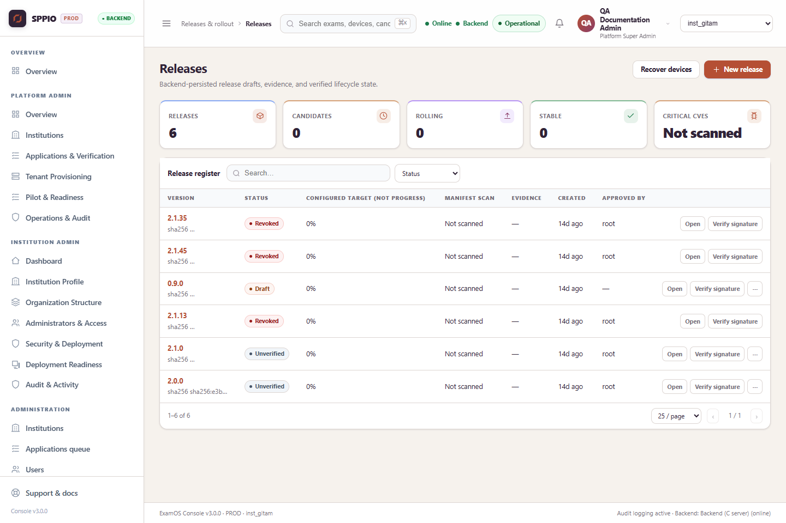

### 6.1 Summary cards

| Card | Meaning |
|---|---|
| **Releases** | Total release records returned by the backend |
| **Candidates** | Releases whose UI status is `candidate` (backend `signed` **and** manifest signature verified) |
| **Rolling** | Releases in `rolling` or `paused` UI state |
| **Stable** | Releases in `stable` UI state |
| **Critical CVEs** | Sum of critical findings when scan data exists; otherwise **Not scanned** |

> **Not scanned is not zero.** If the console displays *Not scanned*, no vulnerability scan result exists. Do not read this as "no vulnerabilities".

### 6.2 The release register

Columns:

| Column | Meaning and caveat |
|---|---|
| **Version** | Semantic version; the link opens the release detail page. The small text is the first 10 characters of the stored manifest digest. |
| **Status** | UI status derived from backend status **and** signature verification. See §16. |
| **Configured target (not progress)** | The rollout percentage recorded for the release. It is a configuration value, **not** the percentage of devices updated. |
| **Manifest scan** | Vulnerability findings associated with the manifest. Shows **Not scanned** when no scan exists. |
| **Evidence** | Number of submitted evidence records. Submission is not validation. |
| **Created** | Relative creation time. |
| **Approved by** | Recorded approver, if any. |
| **Actions** | Contextual actions described below. |

Features:

- **Search** filters by version.
- **Status filter** offers `draft`, `candidate`, `unverified`, `approved`, `rolling`, `paused`, `stable`, `revoked`, `superseded`.
- **Pagination** is available at the bottom right (25 per page in the screenshot).
- The list refreshes automatically every 30 seconds.

### 6.3 Row actions

| Action | When it appears | What it actually does |
|---|---|---|
| **Open** | Always | Opens the release detail page |
| **Verify signature** | Always | Calls the backend signature verifier and reports the real result |
| **Approve** | UI status `candidate` **and** `release.approve` | Opens the approval-request dialog (does **not** approve directly) |
| **Roll out** | UI status `approved`, `rolling`, `stable` or `paused` **and** `release.rollout` | Opens the deployment-plan dialog |
| **Revoke** | Release not already revoked **and** `release.manage` | Opens the revocation dialog |

### 6.4 Page-level actions

- **Recover devices** (`release.manage`) — finds the highest stable release and submits recovery requests for devices still reporting a revoked release. See §13.1.
- **New release** (`release.manage`) — creates a draft. See §7.

---

## 7. Creating a release draft

Select **New release**.

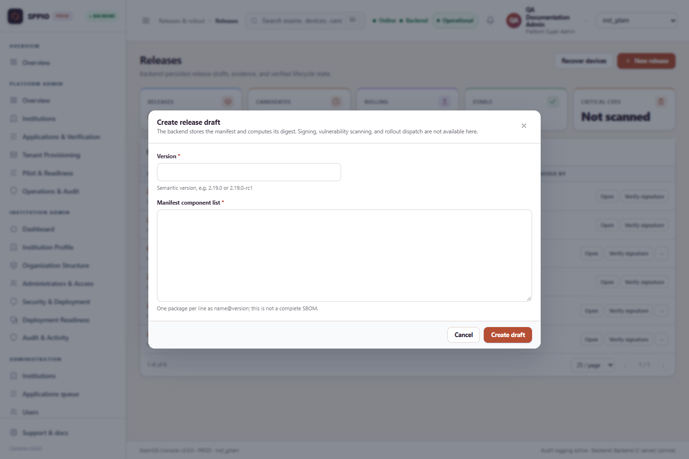

### 7.1 Fields

| Field | Required | Validation / behaviour |
|---|:---:|---|
| **Version** | Yes | Must be semantic: `2.19.0` or `2.19.0-rc1`. Maximum 30 characters. Duplicate versions are rejected. |
| **Manifest component list** | Yes | One package per line as `name@1.2.3`. At least one line is required. Maximum 12,000 characters. |

Component-line rules:

- Package name: 1–60 characters from letters, digits, `.`, `_`, `-`; matched case-insensitively and normalized to lower case.
- Version: three numeric components, optionally followed by a lowercase prerelease suffix.
- Lines are sorted by package name before the manifest is stored.
- Invalid input is rejected with a line-specific message, for example `Line 3: use name@1.2.3`.

### 7.2 What happens on **Create draft**

The console posts the release to the backend. The backend:

1. Allocates a release identifier.
2. Stores the manifest JSON.
3. Computes the manifest digest.
4. Creates a **draft** with `manifest_verified: false`.

The success message is explicit: the draft is persisted but **is not signed, vulnerability-scanned, or eligible for rollout**.

### 7.3 What the draft is not

- It is **not** an OS build.
- It is **not** a signed manifest.
- The component list is **not** a complete SBOM.
- It cannot be approved or rolled out until the backend trust gates pass.

> A release must originate from a real build with real artifacts. Never use this form to represent a release that has not actually been built.

---

## 8. Release detail page

Open any row with **Open**. The example below is the preserved baseline `2.0.0`, shown as **Unverified** by the status safety rule described in §8.4.

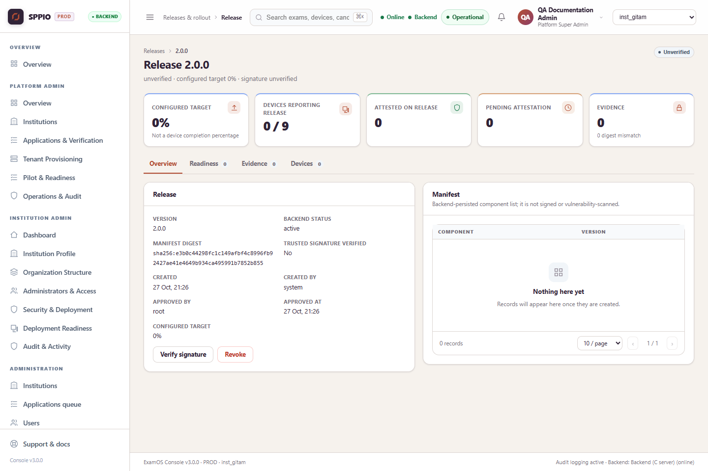

### 8.1 Header

- Release version.
- UI status badge.
- Subtitle: current status, configured target, and whether the manifest signature is verified.

### 8.2 Summary cards

| Card | Meaning |
|---|---|
| **Configured target** | Recorded rollout percentage. Subtitle: *Not a device completion percentage*. |
| **Devices reporting release** | Number of registered devices whose stored release matches this release, over the total registered devices. |
| **Attested on release** | Devices whose latest backend trust outcome is `ALLOW`. |
| **Pending attestation** | Devices on the release without an `ALLOW` outcome. |
| **Evidence** | Submitted evidence records and digest mismatches. |

### 8.3 Tabs

#### Overview

Two cards:

- **Release** — version, backend status, manifest digest, trusted-signature flag, created time/by, approved by/at, configured target.
- **Manifest** — the stored component list. The card states plainly that it is **not signed or vulnerability-scanned**.

Action buttons:

| Button | Condition | Behaviour |
|---|---|---|
| **Verify signature** | Always | Runs real backend verification. See §8.4. |
| **Approve** | UI `candidate` + `release.approve` | Opens the approval-request dialog. |
| **Roll back** | `rolling`, `paused`, `stable` or `approved` + `release.rollout` | Submits device recovery requests to an earlier stable release. |
| **Revoke** | Not revoked + `release.manage` | Revokes the release. |

#### Readiness

See §9.

#### Evidence

See §10.

#### Devices

See §11.

### 8.4 Verify signature — what the button really does

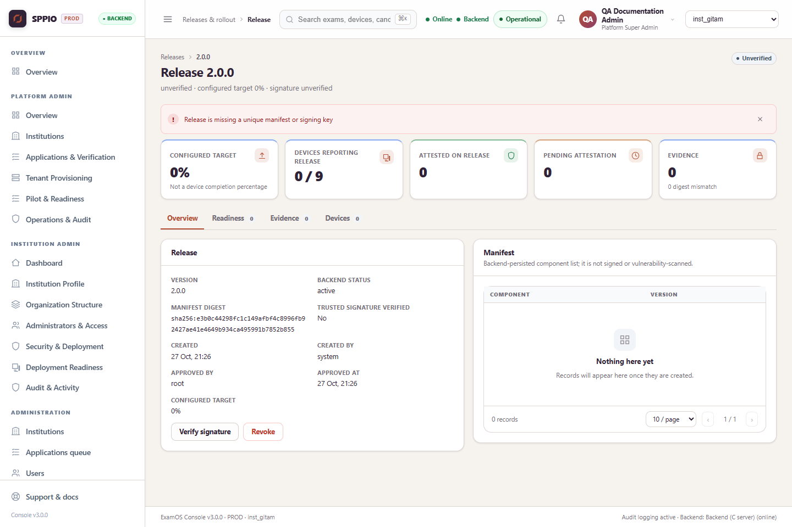

The console calls `POST /api/v1/os/releases/:id/verify-signature`. The backend:

1. Loads the release, its manifest and its signing-key record.
2. Confirms the manifest's `release_id` and `version` match the release.
3. Requires the signing key to be **active** and of type **production**.
4. Independently verifies the cryptographic signature over the canonical manifest.
5. Persists the result and updates trust state only if verification succeeds.

For the preserved `2.0.0` baseline, verification correctly fails closed with:

> **Release is missing a unique manifest or signing key**

This is the expected outcome for the seeded baseline: migration 023 created placeholder signature/artifact material and no usable build provenance. The failed verification does not delete the release or its history.

> **Never treat a green "active" backend status as proof of trust.** `2.0.0` is stored as `active` but is displayed as **Unverified** because its signature is not verified.

### 8.5 Approval request and separation of duties

Selecting **Approve** opens a reason dialog. The console then:

1. Re-checks `release.approve`.
2. Requires UI status `candidate`.
3. Rejects self-approval when the signed-in user is the release creator.
4. Re-runs signature verification.
5. Requires a justification of at least 8 characters.
6. Creates a **release-approve** approval request — it does **not** approve the release itself.

The request is handled in the **Approvals** area by a different authorised user. On decision, the backend executes the approval only if:

- the release is in backend status `signed`,
- the approver is not the creator,
- the manifest digest still matches the digest recorded in the request.

**Current limitation:** the release API exposes no route that moves a release into backend status `signed`. The approval-execution query therefore cannot currently succeed for a release created through this UI. Treat the approval step as **BLOCKED** until the signing/build integration sets the signed state. Do not work around it by editing database status.

#### The Approvals area

Approvers work in **Administration → Approvals** (`/admin/approvals`, permission `approval.view`).

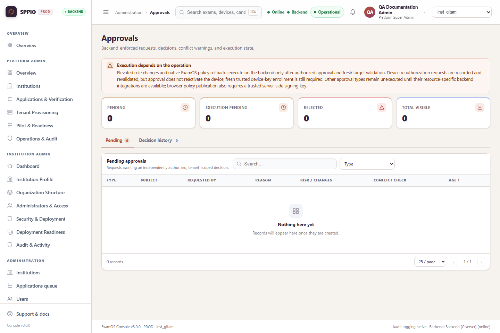

The page shows the pending and decision-history queues, conflict warnings, and the operation-execution notice. In the captured environment it loads correctly with **0** pending, **0** execution-pending, **0** rejected and **0** visible records, because no approval request has been created.

The banner is an honest statement of scope: only role changes and native ExamOS policy rollbacks execute automatically after approval; other approval types remain recorded decisions until their resource-specific backend integration exists. This is why an approved **release-approve** request must not be read as "the release was deployed".

### 8.6 Revoke

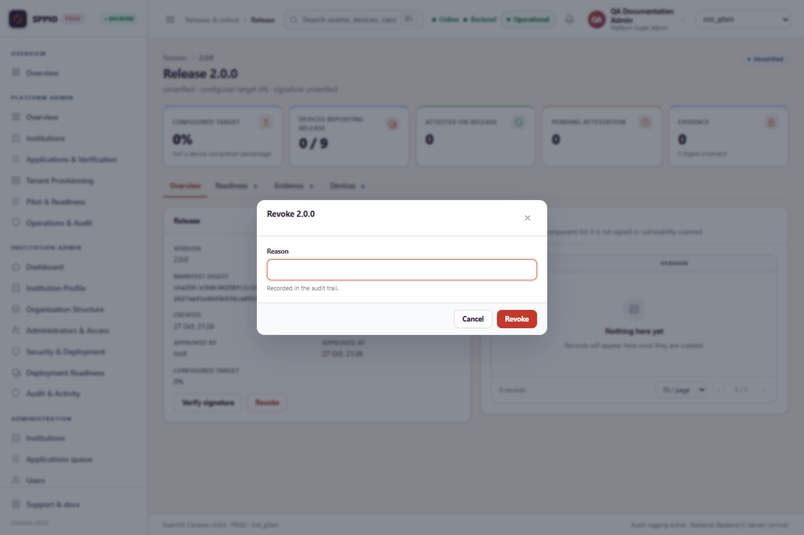

1. Enter a reason of at least 8 characters.
2. Select **Revoke release**.

The backend sets the release to `revoked`, clears rollback permission, and records an audit event. Devices still reporting the revoked release will fail attestation until they are recovered or moved to another release.

Revocation does not uninstall anything and does not delete release history.

### 8.7 Roll back

Available for `rolling`, `paused`, `stable` or `approved`. The console:

1. Requires a reason of at least 10 characters.
2. Finds an earlier stable/superseded release with a lower version.
3. Submits a recovery request for every device reporting the current release.

It does **not** confirm that any device rolled back. Completion requires device acknowledgement and re-attestation.

---

## 9. Readiness gates

Open the **Readiness** tab.

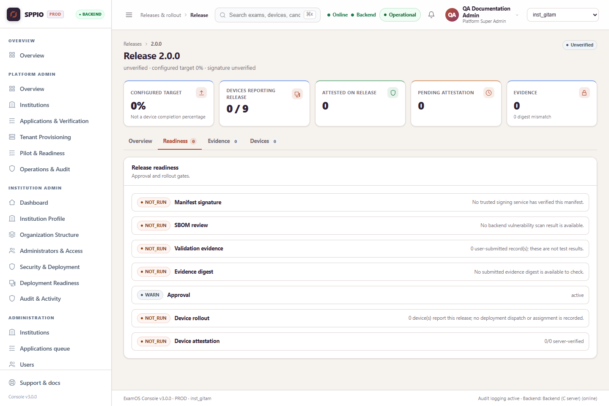

| Gate | PASS when | Other states and meaning |
|---|---|---|
| **Manifest signature** | Backend reports `manifest_verified: true` | `NOT_RUN` — no trusted signing service has verified the manifest |
| **SBOM review** | Never, in this build | Always `NOT_RUN` — no backend vulnerability scan result exists |
| **Validation evidence** | Never, in this build | `WARN` if evidence records exist; `NOT_RUN` otherwise. Text states these are not test results. |
| **Evidence digest** | Never, in this build | `FAIL` if any submitted digest mismatches; `WARN` if digests match; `NOT_RUN` if none |
| **Approval** | Signature verified **and** backend status is `approved`/`staged`/`active`/`suspended` | `WARN` otherwise |
| **Device rollout** | Never, in this build | Always `NOT_RUN` — no deployment assignment or dispatch is recorded |
| **Device attestation** | All devices on the release are `ALLOW` | `WARN` if only some are; `NOT_RUN` if none |

> Readiness is a display of backend facts. It is not a checklist you can satisfy by uploading documents.

---

## 10. Evidence

### 10.1 Evidence tab

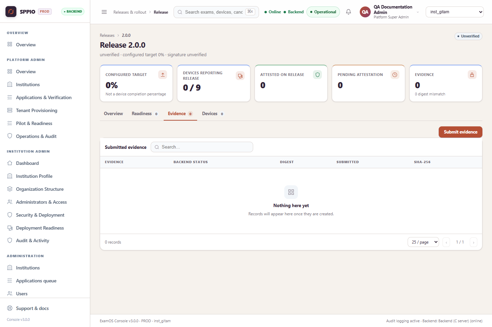

The table shows submitted evidence with:

- title and type,
- classification,
- backend status,
- digest verification state (`digest-matched`, `integrity-mismatch`, `unverified`),
- submission time,
- SHA-256 of the submitted record.

The **Check digest** action re-reads the record from the backend and confirms whether the digest still matches.

### 10.2 Submit evidence

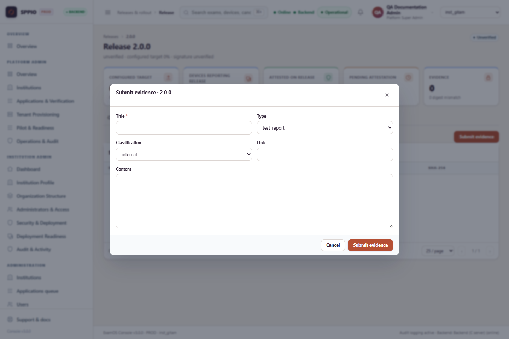

| Field | Required | Notes |
|---|:---:|---|
| **Title** | Yes | At least 4 characters, maximum 120 |
| **Type** | Yes | `test-plan`, `test-report`, `security-review`, `sbom`, `signature`, `rollback-plan`, `performance`, `accessibility`, `other` |
| **Classification** | Yes | `internal`, `confidential`, `restricted`, `auditor-only` |
| **Link** | No | Maximum 300 characters |
| **Content** | No | Maximum 4,000 characters |

The backend computes a digest over type, title, classification, content and link, stores the record as `user_submitted`, and returns a confirmation. The console displays:

> Evidence submitted. It is not a passed validation result.

**Rule:** uploaded or typed evidence never becomes proof of successful automated testing. It does not unlock approval or rollout gates.

### 10.3 Validation & evidence page

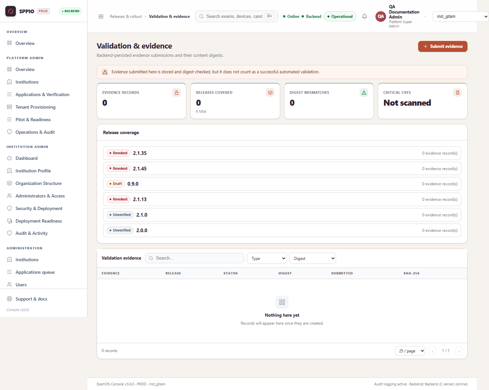

This page aggregates evidence across releases.

Summary cards:

| Card | Meaning |
|---|---|
| **Evidence records** | Total submitted records |
| **Releases covered** | Distinct releases with at least one record, over total releases |
| **Digest mismatches** | Records whose digest no longer matches |
| **Critical CVEs** | Sum of critical findings, or **Not scanned** when scan data is missing |

Sections:

- **Release coverage** — each release, its status and its evidence count.
- **Validation evidence** — searchable table with type and digest filters.
- **Submit evidence** — the same dialog, with an additional release selector.

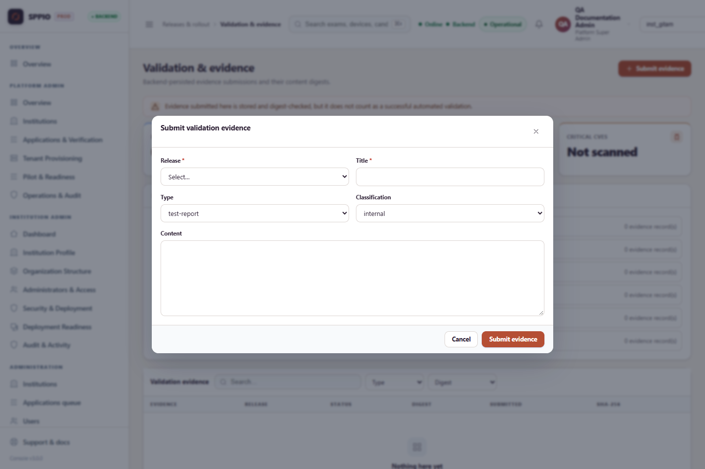

---

## 11. Devices tab

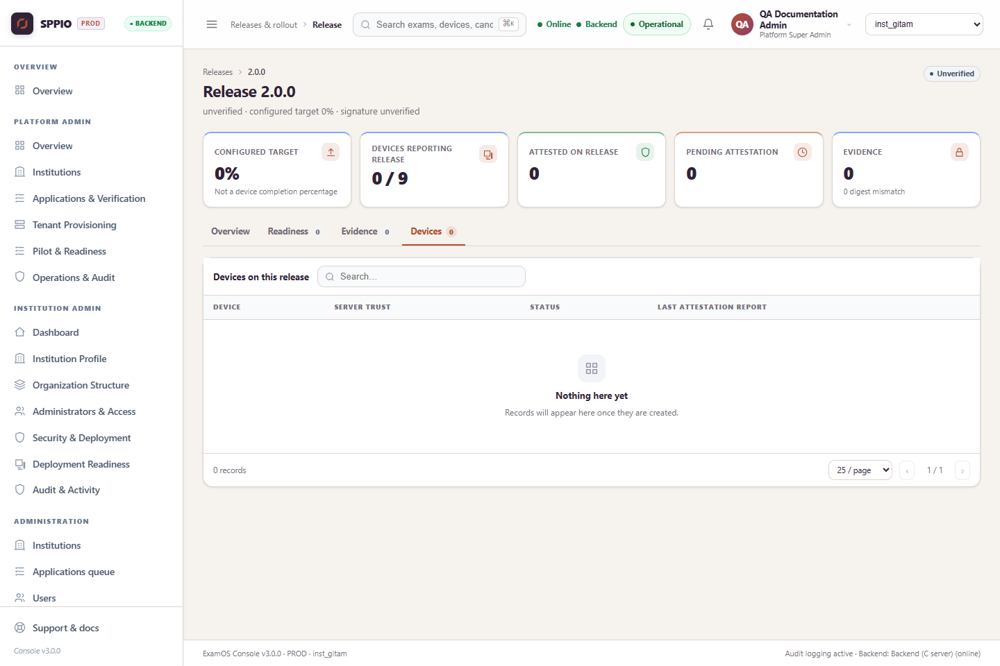

Columns:

| Column | Meaning |
|---|---|
| **Device** | Hostname; links to the device record |
| **Server trust** | `verified` only when the backend trust outcome is `ALLOW`; otherwise `unverified` |
| **Status** | Device lifecycle status |
| **Last attestation report** | Relative time of the last attestation, or `never` |

This tab is a **reporting view**. It does not assign devices, start an update or change device state.

---

## 12. Rollouts page

Open **Releases & rollout → Rollouts**.

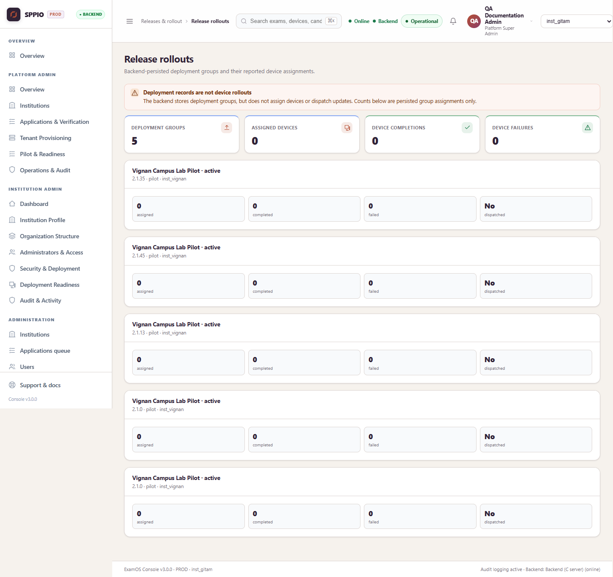

### 12.1 Warning banner

> **Deployment records are not device rollouts.**
> The backend stores deployment groups, but does not assign devices or dispatch updates. Counts below are persisted group assignments only.

This warning is part of the product and must be repeated in institution change records.

### 12.2 Summary cards

| Card | Calculation |
|---|---|
| **Deployment groups** | Number of deployment groups returned |
| **Assigned devices** | Sum of persisted `devices_assigned` values |
| **Device completions** | Sum of persisted `devices_completed` values |
| **Device failures** | Sum of persisted `devices_failed` values |

### 12.3 Deployment group cards

Each card shows:

- group name and backend status,
- target version, rollout stage and institution,
- assigned / completed / failed counts,
- whether the group is marked **dispatched** (`Yes`/`No`).

In the captured environment every group reports `0` assigned and `dispatched: No`. That is the honest state: no device has been dispatched.

### 12.4 Creating a deployment plan

Select **Roll out** on an eligible release (UI status `approved`, `rolling`, `stable` or `paused`).

The dialog:

1. Requires `release.manage`.
2. Requires an eligible UI status.
3. Offers staged targets: **1%**, **5%**, **25%**, **50%**, **100%**.
4. Rejects a target that is not higher than the current configured target.
5. Blocks a downgrade when a higher stable release already exists.
6. Creates a deployment **group** only.

It does **not**:

- select or assign devices,
- dispatch an artifact,
- download or verify an artifact on a device,
- install anything,
- report installation progress.

**Current limitation:** no release in the captured environment reaches an approved/rolling/stable state with a verified signature, so the rollout dialog is gated. Rollout planning is **BLOCKED** until a verified, approved release exists. Additionally, the platform-super-admin account has no institution tenancy, so a deployment group created without selecting an institution cannot satisfy the institution foreign key. Create rollout plans from an institution-scoped account with a real tenant.

---

## 13. Suspension, revocation, retirement and recovery

| Operation | Where | Effect | Honest limitation |
|---|---|---|---|
| **Suspend** | Backend route `/suspend`; UI exposes the resulting `paused` state | Marks release suspended | No pause/resume controls exist in the UI yet |
| **Revoke** | Release row/detail | Status `revoked`; rollback disabled; devices fail attestation | Does not uninstall from devices |
| **Retire** | Backend route `/retire`; no direct UI button in these pages | Status `retired` | Historical record retained |
| **Roll back** | Release detail | Submits device recovery requests to an earlier stable release | Completion not verified |
| **Recover devices** | Releases page | Submits recovery requests for devices on revoked releases | Requires a stable target release |
| **Pause/resume rollout** | Not available | — | Service returns an explicit "not supported" error |

### 13.1 Recover devices

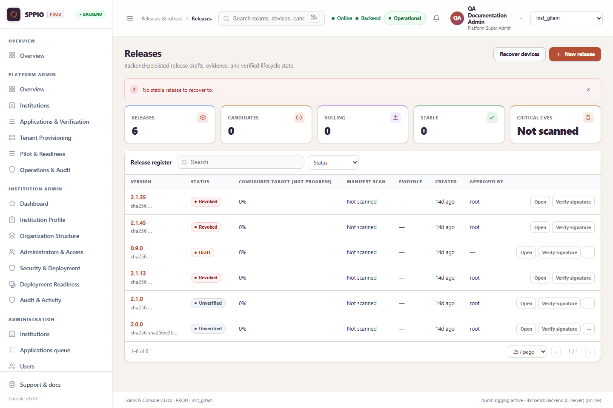

If no stable release exists, the console reports:

> **No stable release to recover to.**

If a stable release exists and devices are on revoked releases, the console submits one recovery request per device and states that device completion is not yet verified.

---

## 14. Revoked release example

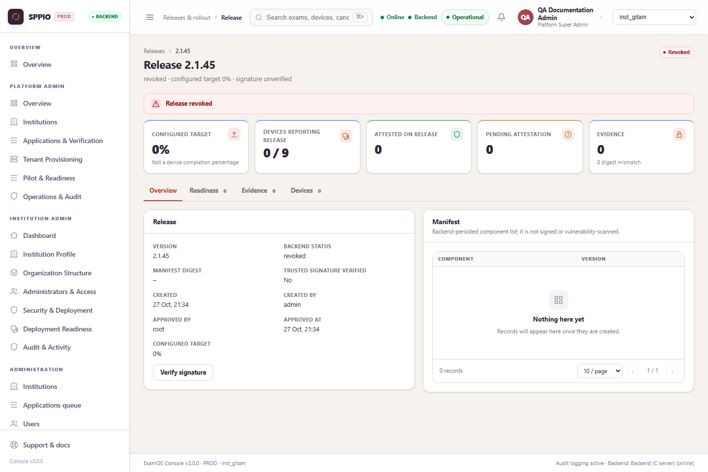

A revoked release:

- displays a red **Release revoked** alert,
- shows UI status **Revoked**,
- does not offer **Revoke** again,
- does not offer **Roll back**,
- remains in the register and retains its history.

The revocation reason is shown only if one was recorded. Older seeded records may have no reason.

---

## 15. End-to-end institution runbook

Use this sequence for every release. Do not skip steps or reorder approval before verification.

| # | Step | Actor | Page / action | Required result |
|---|---|---|---|---|
| 1 | Confirm change record and maintenance window | Release manager | Institution change process | Approved change reference |
| 2 | Confirm build provenance and artifacts | Release engineer | Build system (outside these pages) | Real build record, artifacts, SHA-256, SBOM, provenance |
| 3 | Create the release draft | `release.manage` | Releases → New release | Draft persisted, `manifest_verified: false` |
| 4 | Verify the manifest signature | Any `release.view` user (the button is always shown) | Release detail → Verify signature | Backend reports a genuinely verified signature, or the release stays unverified |
| 5 | Submit supporting evidence | `release.manage` | Evidence → Submit evidence | Records persisted with digests; not treated as test results |
| 6 | Review readiness | Release manager + security | Readiness tab | All mandatory gates understood; blockers recorded |
| 7 | Request approval | `release.approve` | Release detail → Approve | Approval request created with reason and manifest digest |
| 8 | Decide the approval | Different authorised approver | Approvals area | Approval recorded against the same digest |
| 9 | Create the deployment plan | `release.rollout` **and** `release.manage` | Release → Roll out | Deployment group persisted; **no devices assigned** |
| 10 | Dispatch and install | Device agent / deployment system | Outside these pages | Authenticated delivery, hash check, installation, reboot |
| 11 | Verify boot and attestation | Security operations | Devices / attestation views | Secure Boot and TPM evidence for that device |
| 12 | Monitor and report | Release manager | Rollouts page | Reported counts; distinguish group records from device results |
| 13 | Suspend / revoke / recover if needed | `release.manage` / `release.rollout` | Release detail actions | State changed and audited; recovery requests submitted |

### Staged rollout model

The UI stages are **1% → 5% → 25% → 50% → 100%**. In a complete pipeline these stages should map to device cohorts:

1. Internal test devices
2. QA devices
3. Pilot institution
4. Limited production
5. Wider production

In the current build the percentage is a **configured target**, not a cohort assignment. Do not tell device owners that 25% of devices have been updated.

---

## 16. Status reference

### 16.1 UI status mapping

| Backend status | UI status | Notes |
|---|---|---|
| `draft` | `draft` | Newly created; not signed |
| `built` | `draft` | No build workflow is exposed in these pages |
| `validated` | `draft` | — |
| `signed` | `unverified` | Becomes `candidate` only when `manifest_verified` is true |
| `approved` | `approved` | Forced to `unverified` if the manifest is not verified |
| `staged` | `rolling` | Forced to `unverified` if the manifest is not verified |
| `active` | `stable` | Forced to `unverified` if the manifest is not verified |
| `suspended` | `paused` | Forced to `unverified` if the manifest is not verified |
| `revoked` | `revoked` | — |
| `retired` | `superseded` | — |
| Unknown | Raw value | Investigate |

### 16.2 Why `active` can display as `Unverified`

This is a deliberate safety rule. The UI only shows `approved`, `rolling`, `stable` or `paused` when the backend reports `manifest_verified: true`. Otherwise the release is displayed as **Unverified**, even if the database status says `active`.

This protects institutions from seed data, migrated data or manual status edits that were never cryptographically verified.

---

## 17. Capability and evidence status

Statuses follow the project's definitions: **PASS** = executed and verified; **FAIL** = executed and failed; **BLOCKED** = missing infrastructure/authorization; **NOT TESTED** = not executed.

| Capability | Status | Evidence / reason |
|---|---|---|
| Management sign-in + MFA | **PASS** | Executed against the live backend and PostgreSQL |
| Releases list, search, filter, pagination | **PASS** | Executed; screenshot 03 |
| Release detail rendering | **PASS** | Executed; screenshot 05 |
| Draft creation dialog and validation rules | **NOT TESTED** in this documentation run | Dialog exercised only; no record submitted |
| Backend signature verification endpoint | **PASS** (fail-closed) | Executed on the baseline; returned `409 Release is missing a unique manifest or signing key` |
| Independent signature verification success | **BLOCKED** | No valid signed release, signing service or production key in this environment |
| Approval request creation | **BLOCKED** | Requires UI `candidate`; no release can reach `signed` |
| Approvals page (`/admin/approvals`) loading | **PASS** | Executed; empty queues returned by the backend (`GET /api/v1/approvals` → `200 []`); screenshot 17 |
| Approval execution | **BLOCKED** | Backend requires status `signed`; no route sets it |
| SBOM generation/review | **BLOCKED** | No SBOM artifact or scanner result |
| Vulnerability scanning and gates | **BLOCKED** | No scanner integration or scan data |
| Deployment plan creation | **BLOCKED** | No approved, verified release |
| Device assignment and dispatch | **BLOCKED** | Not implemented in this release |
| Installation progress and result reporting | **BLOCKED** | Not implemented in this release |
| Pause/resume rollout | **NOT TESTED** | No control exists; the service is hard-coded to return an unsupported-operation error |
| Rollback execution | **BLOCKED** | Only recovery requests are submitted; no stable earlier target in the captured data |
| Device recovery completion | **BLOCKED** | Requires device acknowledgement and re-attestation |
| Physical Secure Boot / TPM attestation | **BLOCKED** | Needs genuine hardware; not claimed from this software environment |

---

## 18. Troubleshooting

| Message | Cause | Correct action |
|---|---|---|
| `Invalid username or password, or account is inactive` | Wrong credentials or disabled account | Verify account status with your platform administrator |
| `Invalid authentication code or recovery code` | Expired/wrong TOTP or used recovery code | Use the current code; ensure device clock is correct; use an unused recovery code |
| `Version must look like 2.19.0 or 2.19.0-rc1.` | Version is not semantic | Correct the version |
| `That version already exists.` | Duplicate version | Use a new version |
| `Line N: use name@1.2.3` | Invalid component line | Fix the line; one `name@version` per line |
| `List at least one SBOM component.` | Empty component list | Add at least one component |
| `Backend did not confirm an unsigned, persisted release draft.` | Backend version mismatch or rejected request | Check backend health and logs |
| `Release is missing a unique manifest or signing key` | Release has no usable manifest/key, or duplicate rows | Treat as unverified; do not approve or deploy |
| `The backend has not verified a trusted signature for this release.` | Signature verification failed | Keep the release unverified; investigate build/signing |
| `Only candidates can be approved.` | Release is not in UI `candidate` | Complete signature verification first |
| `The builder cannot approve their own release (separation of duties).` | Same user created and approves | Use a different authorised approver |
| `Backend has not verified a trusted manifest signature.` | Verification not successful | Re-run verification after fixing signing evidence |
| `Enter a reason of at least 8 characters.` / `Reason needs 8+ characters.` | Reason too short for approval or revocation | Provide a meaningful justification |
| `Enter a reason of at least 10 characters.` | Reason too short for rollback/recovery | Provide a more detailed justification |
| `No stable release to recover to.` | No stable target exists | Publish/approve a stable release first |
| `No devices are on a revoked release.` | Nothing to recover | No action required |
| `Approve the release before rolling it out.` | Release not approved | Complete verification and approval |
| `Choose 1, 5, 25, 50 or 100%.` | Invalid stage | Pick a supported stage |
| `Already at X%. Pick a higher step.` | Target is not an increase | Pick a higher stage |
| `Downgrade blocked: X is already stable.` | Attempt to roll out an older version | Use the newer stable version or an authorised recovery process |
| `No earlier stable release is available as a rollback target.` | No lower stable release | Use the documented recovery process |
| `Rollout groups do not yet support pause controls; release state was not changed.` | Pause not implemented | Suspend or revoke the release instead |
| `Advisory management is unavailable until a trusted backend vulnerability feed is configured.` | No vulnerability feed | Do not claim advisory coverage |
| `OS release or deployment endpoint not found` | Frontend/backend version mismatch (stale backend binary) | Deploy matching versions; rebuild backend |

---

## 19. Audit and recordkeeping

Release actions append audit events. Typical events include:

- `OS_RELEASE_CREATED`
- `OS_RELEASE_EVIDENCE_SUBMITTED`
- release signature verification results
- `OS_RELEASE_ACTIVATED`
- `OS_RELEASE_REVOKED`
- `OS_RECOVERY_REQUESTED`
- approval request creation/decision events

Evidence records carry a SHA-256 digest and can be re-checked from the UI. The audit ledger is hash-linked so that selected changes may be detectable; this does **not** by itself guarantee non-repudiation or regulatory compliance.

Institution recordkeeping recommendations:

1. Export the release register and approval decision for each change.
2. Store the build provenance, artifact hashes and SBOM outside the console in your artifact repository.
3. Keep the screenshot or PDF of the readiness tab with the change record.
4. Record explicitly that the Rollouts page is a deployment-group register, not installation evidence.
5. Retain revocation and recovery reasons.

---

## 20. Glossary

| Term | Meaning |
|---|---|
| **Release** | A versioned OS release record with a manifest and lifecycle state |
| **Manifest** | The component list and release metadata; canonicalized before signing |
| **Manifest digest** | SHA-256 digest of the canonical manifest |
| **Signature verification** | Backend cryptographic check of the manifest signature against a trusted public key |
| **Candidate** | A signed release with a verified manifest signature, eligible for approval |
| **Evidence** | A submitted record supporting a release; not an automated test result |
| **Readiness gate** | A backend-derived check displayed on the Readiness tab |
| **Deployment group** | A persisted rollout plan record; not a device assignment |
| **Recovery request** | A request asking a device to move to another release; completion must be acknowledged |
| **Attestation** | Device-reported integrity evidence evaluated by the backend |
| **UI status** | The status shown in the console after applying signature-verification safety rules |

---

## Appendix A — Backend endpoints used by these pages

| Method | Endpoint | Purpose |
|---|---|---|
| `GET` | `/api/v1/os/releases` | List releases |
| `POST` | `/api/v1/os/releases` | Create a draft |
| `GET` | `/api/v1/os/releases/:id` | Release detail, manifest, artifacts, evidence |
| `POST` | `/api/v1/os/releases/:id/verify-signature` | Verify the manifest signature |
| `POST` | `/api/v1/os/releases/:id/validate` | Submit evidence |
| `POST` | `/api/v1/os/releases/:id/approve` | Disabled; returns `409` directing to the approval workflow |
| `POST` | `/api/v1/os/releases/:id/activate` | Activate a trusted, approved release |
| `POST` | `/api/v1/os/releases/:id/suspend` | Suspend a release |
| `POST` | `/api/v1/os/releases/:id/revoke` | Revoke a release |
| `POST` | `/api/v1/os/releases/:id/retire` | Retire a release |
| `GET` | `/api/v1/os/deployments` | List deployment groups |
| `POST` | `/api/v1/os/deployments` | Create a deployment group |
| `POST` | `/api/v1/approvals` | Create an approval request |
| `GET` | `/api/v1/approvals` | List approval requests |
| `POST` | `/api/v1/approvals/:id/decision` | Record an approval decision |
| `POST` | `/api/v1/os/devices/:id/recovery` | Submit a device recovery request |

Direct release approval is intentionally disabled. Approval must go through the central approval workflow so that requester and approver are distinct.

---

## Appendix B — Screenshot index

| File | Contents |
|---|---|
| `screenshots/01-login.png` | Management console sign-in |
| `screenshots/02-mfa.png` | Two-factor authentication |
| `screenshots/03-releases-list.png` | Release register with mixed statuses |
| `screenshots/04-create-release-draft.png` | Create release draft dialog |
| `screenshots/05-release-detail-overview.png` | Baseline release shown as Unverified |
| `screenshots/06-release-readiness.png` | Readiness gates with `NOT_RUN`/`WARN` states |
| `screenshots/07-release-evidence-empty.png` | Empty evidence table |
| `screenshots/08-release-evidence-dialog.png` | Submit evidence dialog |
| `screenshots/09-release-devices.png` | Devices reporting the release (none) |
| `screenshots/10-revoke-dialog.png` | Revocation confirmation |
| `screenshots/11-rollouts.png` | Deployment groups with zero assignments and no dispatch |
| `screenshots/12-release-validation.png` | Validation & evidence overview |
| `screenshots/13-validation-evidence-dialog.png` | Submit validation evidence dialog |
| `screenshots/14-release-revoked.png` | Revoked release detail |
| `screenshots/15-verify-signature-result.png` | Fail-closed signature verification |
| `screenshots/16-recover-devices-result.png` | Recovery blocked with no stable release |
| `screenshots/17-approvals-empty.png` | Approvals area with empty pending/decision queues |

---

## Appendix C — How the screenshots were produced (evidence statement)

- **Environment:** local development deployment on 11 November 2026.
- **Frontend:** SPPIO console v3.0.0 served by Vite at `http://127.0.0.1:5173`.
- **Backend:** the real `examos-server` binary, rebuilt from the repository, listening on `127.0.0.1:8895`.
- **Database:** PostgreSQL 18 with the repository migrations, including the release-engineering schema and the centralized approval-governance schema (`031`). The approvals schema was applied before the final Approvals screenshot; this created empty approval tables and the standard approval policies, and did not alter any release record.
- **Browser:** Google Chrome, 1440×960 viewport, real DOM screenshots — not mock-ups or edited images.
- **Account:** a temporary local QA administrator was created solely to render the authenticated pages. It was removed after capture. The screenshots show its display name, not an institutional identity.
- **Data:** the release records visible in the screenshots are the existing local records, including the preserved `2.0.0` baseline. No release was created, approved, signed or deployed to produce this guide.
- **Telemetry:** the console footer shows `PROD` and the header shows `Operational`; these are UI labels, not a claim that the captured environment is a production deployment.
- **Not claimed:** no physical Secure Boot, TPM attestation, device installation or production rollout is evidenced by these screenshots.
